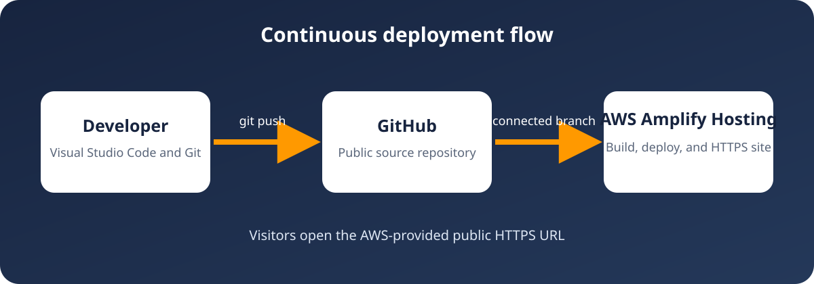

# AWS Cloud Foundations Explorer

A beginner-friendly, interactive guide to cloud concepts and foundational AWS services. This project was built as portfolio evidence after introductory AWS learning.

## Live demo

Add the AWS Amplify Hosting URL to the repository About panel after deployment.


## Features

- Four concise cloud concept cards
- Six foundational AWS service cards
- An interactive service-selection quiz
- Responsive HTML and CSS with no framework dependencies
- Continuous deployment from GitHub to AWS Amplify Hosting
- Architecture and cloud-concept documentation

## Architecture



The source is edited in Visual Studio Code, versioned with Git, stored on GitHub, and deployed by AWS Amplify Hosting. A push to the connected `main` branch starts a new deployment.

Read the detailed explanation in [docs/architecture.md](docs/architecture.md).

## Repository structure

```text
aws-cloud-foundations-explorer/
├── README.md
├── index.html
├── css/
│   └── styles.css
├── js/
│   └── app.js
├── assets/
│   └── architecture.svg
└── docs/
    ├── architecture.md
    ├── cloud-concepts.md
    └── screenshots/
        ├── amplify-deployment.png
        └── live-site.png
```

## Run locally

Open `index.html` in a web browser. No package installation or build command is required.

## Deployment

1. Push the repository to GitHub.
2. Connect the `main` branch to AWS Amplify Hosting.
3. Open the generated default domain after the deployment completes.
4. Push another visible update and confirm that Amplify deploys it automatically.

## Security and cost decisions

- No credentials, access keys, tokens, account IDs, or personal data belong in this repository.
- The project has no backend and collects no user data.
- The project uses the AWS-provided default domain instead of a paid custom domain.
- The Amplify GitHub App is limited to this repository.
- The AWS Amplify app can be deleted while the GitHub source remains available.

## Evidence

- [Live-site screenshot](docs/screenshots/live-site.png)
- [Amplify deployment screenshot](docs/screenshots/amplify-deployment.png)
- [Cloud concepts](docs/cloud-concepts.md)
- [Architecture explanation](docs/architecture.md)

## Official references

- [AWS Cloud Essentials](https://aws.amazon.com/getting-started/cloud-essentials/)
- [AWS Amplify Hosting documentation](https://docs.aws.amazon.com/amplify/latest/userguide/welcome.html)
- [Amplify access to GitHub repositories](https://docs.aws.amazon.com/amplify/latest/userguide/setting-up-GitHub-access.html)


Tracking number:
WTC-MFH76CEJ
